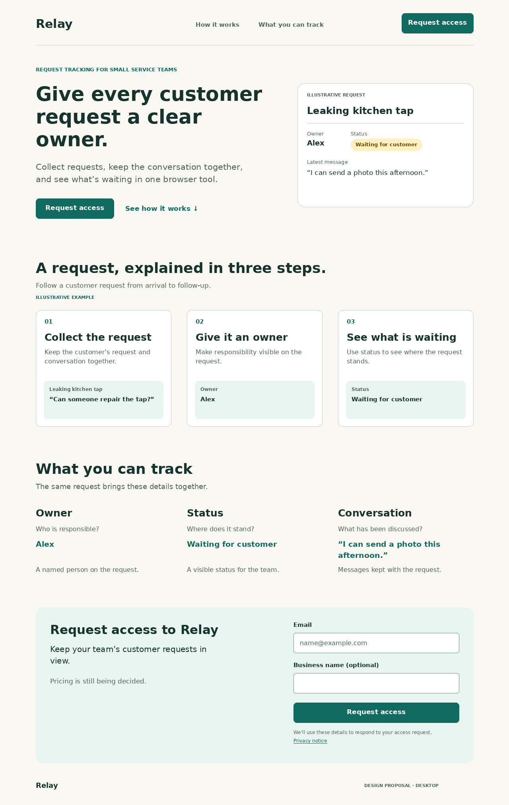
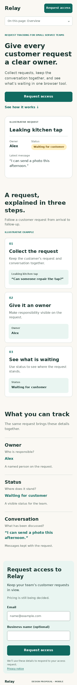

# Relay landing page — design

**Selected design:** a single page that explains one customer request, makes the product’s scope visible, and leads to an access request. The design endpoint is complete. Implementation is a later step.

The deliverable includes this specification and two static composition studies: [desktop](design-desktop.png) and [mobile](design-mobile.png). These are proposed layouts with illustrative data. They are not screenshots of a running Relay product.

## 1. What visitors should understand and do

A visitor should be able to explain four things after reading the page:

1. **What Relay is and who it serves:** a browser tool for small service businesses handling customer requests.
2. **What it organizes:** each request has a responsible person, a visible status, and its associated conversation.
3. **How that helps their work:** they can see who is responsible and what is waiting, illustrated through one concrete request.
4. **What to do next:** request access using an email address. Pricing is still being decided.

The assumed visitor is an owner, manager, or team member assessing a tool for their service business. This is a working audience hypothesis derived from the supplied business description; research with this audience has not been supplied. Their entry could be a shared link, a search result, or a direct link to a section.

The page covers the explanation and access-request flow. The internal product workflow appears only as an illustrative example.

## 2. Evidence, scope, and assumptions

| Status | Evidence or decision | Consequence |
| --- | --- | --- |
| Reported in `BRIEF.md` | Relay collects requests, assigns responsibility, and shows request status. | These capabilities form the main message and demonstration. |
| Observed in supplied copy | “Keep the conversation together” is part of the rough proposition. | Conversation is shown alongside owner and status; the exact collection mechanism remains open. |
| Reported in `BRIEF.md` | The initial action is to request access; pricing is undecided. | All primary calls to action use **Request access**. Include a plain pricing-status statement near the form. |
| Observed in supplied material | The speed claim has no supplied study or customer evidence. | Exclude “Teams resolve requests twice as fast” from page copy. Use the concrete capabilities to explain value. |
| Reported preferences | The user likes compact inclusions, a three-step explanation, and visible position in a hierarchy. | Adapt those purposes to this page’s actual content. |
| Observed material limit | The references are descriptions. Original URLs, screenshots, brand assets, and an existing interface were not supplied. | No original reference site was visited or evaluated. The professional sources below are separate research. |
| Decision | Use one connected page with an inline request form. | The visitor can read, jump to a relevant section, and submit without a separate page or overlay. |
| Hypothesis | Email follow-up is a suitable access-request handoff. | The proposed form and completion text depend on the business owning that follow-up process. |
| Unknown | Capture channels, integrations, actual status vocabulary, access eligibility, response timing, price, and privacy destination. | Keep these out of factual product promises; assign them explicitly in the handoff. |

## 3. How the liked reference fragments are used

| Supplied fragment and valued quality | Chosen transfer | Applicability and limit |
| --- | --- | --- |
| Pricing page: compact columns make inclusions easy to compare. | A compact **What you can track** section gives owner, status, and conversation the same sequence: question answered, sample value, short explanation. | These are complementary parts of one request. No plans, prices, tiers, competitor comparisons, or availability differences are invented. The useful transfer is aligned, consistent information. |
| Product page: one task explained through three annotated steps. | Follow the same fictional request through **Collect the request → Give it an owner → See what is waiting**. Each step calls attention to one meaningful part of the record. | The steps are visible together on desktop and in reading order on mobile. The page does not depend on a carousel, animation, video, or hover. |
| Documentation site: visible location in a hierarchy. | Use named sections, matching anchor links, and a clear current-section indicator. | The supplied landing-page content has no documented hierarchy requiring nested navigation. Location is expressed through the current section. Add deeper navigation only if real destinations are created later. |

**Research question:** which parts of comparison and wayfinding patterns fit a small, single-product page?

NN/g’s comparison-table guidance ties full comparison tables to evaluating multiple offerings and stresses consistent information. It supports retaining the reference’s scannability while using a factual capability summary here. This is practitioner guidance, not evidence of Relay visitor behavior. [S1]

NN/g’s breadcrumb guidance connects breadcrumbs to real hierarchical location and discusses their limited usefulness in flat structures. This supports a section-based page with clear location. The selected navigation is a design judgment for this content. [S2]

A lightweight alternative was considered: a split product site with separate feature, pricing, and documentation destinations. The supplied content supports one explanation and one action; separate destinations would require material that has not been supplied. The selected page keeps the complete decision context together. Pricing and documentation can become destinations when their content exists.

## 4. Page structure and proposed copy

### Header and section navigation

Use a provisional text wordmark, **Relay**, linking to `#overview`. On desktop, show **How it works** (`#how-it-works`), **What you can track** (`#what-you-can-track`), and a prominent **Request access** link (`#request-access`). The header has a thin lower rule and uses the same content alignment as the body.

The header can remain sticky on roomy screens. Highlight the currently visible section with weight and an underline; expose `aria-current="location"` on the corresponding link. Scrolling alone does not add history entries or move keyboard focus. Clicking an anchor creates an ordinary meaningful location change, and direct fragment links work.

On narrow screens, keep the wordmark and access action in the first row. Provide an **On this page: [current section]** disclosure below it. Expanded contents are ordinary links in document order: Overview, How it works, What you can track, Request access. Use a native disclosure or a correctly named button with expanded state. A selection closes the list and moves to that section. At enlarged text or short viewport heights, let the header scroll with the document so it does not cover content.

### 1 — Overview (`#overview`)

**Eyebrow:** Request tracking for small service teams

**H1:** Give every customer request a clear owner.

**Body:** Collect requests, keep the conversation together, and see what’s waiting in one browser tool.

**Primary action:** Request access

**Secondary link:** See how it works

Place a small, static request example beside the text on desktop and beneath the actions on mobile. Label it **Illustrative request**. It contains:

| Field | Illustrative content |
| --- | --- |
| Request | Leaking kitchen tap |
| Owner | Alex |
| Status | Waiting for customer |
| Latest message | “I can send a photo this afternoon.” |

These names, messages, and status words are demonstration content. They show the relationship between the supplied capabilities. Keep the entire status phrase legible. The sample has no pretend controls or implied live data.

### 2 — How it works (`#how-it-works`)

**H2:** A request, explained in three steps.

**Lead:** Follow a customer request from arrival to follow-up.

Add a small **Illustrative example** label to the group. Preserve one request identity through all three stages.

| Step | Proposed explanation | Annotation in the example |
| --- | --- | --- |
| **1. Collect the request** | Keep the customer’s request and conversation together. | “Leaking kitchen tap” with the sample message “Can someone repair the tap?” |
| **2. Give it an owner** | Make responsibility visible on the request. | The owner field displays Alex. |
| **3. See what is waiting** | Use status to see where the request stands. | The status displays Waiting for customer, with the photo message available as context. |

Use short numbered annotations and a repeated record treatment. Describe the visible organization without claiming automatic import, particular messaging integrations, automatic assignment, notifications, or an exact internal application lifecycle. The collection mechanism must be confirmed before illustrating its controls.

### 3 — What you can track (`#what-you-can-track`)

**H2:** What you can track

**Lead:** The same request brings these details together.

| Content sequence | Owner | Status | Conversation |
| --- | --- | --- | --- |
| Question answered | Who is responsible? | Where does it stand? | What has been discussed? |
| Example | Alex | Waiting for customer | “I can send a photo this afternoon.” |
| Explanation | A named person on the request. | A visible status for the team. | Messages kept with the request. |

On desktop, align the three groups as columns. On mobile, stack the same groups with dividers and retain each group’s label, question, example, and explanation. A semantic list of three groups is suitable; a data-table component is unnecessary because no row-by-row choice between offerings is required. Keep the full example available rather than silently truncating it.

### 4 — Request access (`#request-access`)

**H2:** Request access to Relay

**Body:** Keep your team’s customer requests in view.

**Price context:** Pricing is still being decided.

Use one inline form. On desktop, place the explanation on the left and the form on the right inside one pale surface. On mobile, place explanation and pricing first, followed by the fields.

| Field or control | Proposed behavior |
| --- | --- |
| **Email** | Required; persistent visible label. Accept a personal or business email address. Use the appropriate email input and autocomplete. |
| **Business name (optional)** | Optional; retain the explicit optional label. This may give the receiving team useful context; it does not block the request. |
| **Request access** | Submit the form. Header and hero instances are links to this form; this instance is a submit button. |
| Helper text | “We’ll use these details to respond to your access request.” This is proposed copy requiring the business’s confirmed processing practice. |
| **Privacy notice** | An underlined text link to the actual approved destination, once supplied. Keep it visually distinct from helper text. |

Do not introduce a password, payment details, plan choice, demo-booking step, response-time promise, or guaranteed-access claim. The requested outcome is a submitted access request.

### Footer

Keep a small Relay wordmark. The privacy link remains beside the form, where details are entered. Any additional contact or legal destination must be real. The “Design proposal” text in the studies is an artifact label and is excluded from the public page.

## 5. Composition and visual direction

Use a calm, practical treatment with warm light backgrounds, dark green text, restrained teal actions, and clear examples of work. The lack of brand assets is handled with a provisional wordmark and system typography.

The PNGs establish composition, relative emphasis, grouping, and initial form placement. The copy and state rules in this document accompany them for later implementation. Success and error appearances are specified below and are not rendered in these images.

| Decision | Implementation direction |
| --- | --- |
| Content width | Approximately 1,100 CSS px maximum on wide screens; fluid side padding, with about 24 px on phones. Treat the supplied 1,280 px and 390 px studies as reference conditions. |
| Hero | Strong left-aligned title and body, with a quieter request example to the right when space permits. Stack in reading order before either region becomes cramped. |
| Type | System sans-serif; headline about 49 px on desktop and 34 px on a phone, using relative units in code. Body 18–21 px; compact examples 15–17 px. Use line height around 1.45 for body text. Allow natural wrapping. |
| Section rhythm | Generous space between sections; tighter spacing inside a meaningful group. Numbered steps have simple bordered surfaces. The capability summary is aligned text with light dividers rather than another grid of heavy boxes. |
| Action prominence | Teal is reserved primarily for actions, selected navigation, and small emphasis. Repeat the same access label at the header, hero, and form. |
| Status meaning | A light amber badge contains its explicit status text. Meaning is available without color. |
| Form | Visible labels above controls; approximately 48–50 px control heights as a design choice. Input boundaries remain clearly visible; focus uses an additional high-contrast outline. |
| Movement | Static examples; optional restrained section scrolling respects reduced-motion settings. No timed sequence is required to read the explanation. |

**Proposed palette:** background `#FAF8F3`; main text `#17332E`; secondary text `#52645D`; action `#116A60`; pale section surface `#E9F5F1`; status background `#FFF0C4` with text `#6C4800`; input border `#778C82`; white control surfaces.

Calculated contrast ratios for specified solid colors are 12.77:1 for main text/background, 5.92:1 for secondary text/background, 6.45:1 for white/action, 6.08:1 for action/background, 7.22:1 for status text/background, and 5.63:1 for helper text/pale surface. These exceed the 4.5:1 normal-text threshold described in the W3C contrast guidance. The arithmetic checks these pairs only; rendered typography and complete accessibility remain unverified. [S4]

## 6. Access-request flow and material states

All navigation and form behavior here is proposed behavior for the later build.

| State or action | Visible response | Continuation, input, and focus |
| --- | --- | --- |
| A visitor chooses Request access from the header or hero. | The request section comes into view with its title, pricing context, and fields. | Move focus to the section heading when an explicit link is activated; the email field follows in logical keyboard order. Keep existing entered values. |
| Direct entry to `#request-access`. | The same section is visible with enough context to understand Relay and the request. | The page remains readable above it. Browser Back and Forward work with ordinary fragment navigation. |
| Empty or invalid email is submitted. | “Enter your email address.” or “Enter an email address in the format name@example.com.” | Associate the message with the field, expose its invalid state, retain both values, and focus the invalid field. Do not show an error on untouched initial load. |
| Valid submission begins. | The button says “Sending request…”; a brief status is announced. | Prevent repeat submission while pending. Preserve the values and logical focus. The endpoint must validate independently. |
| The service confirms receipt. | **Request received.** “We’ll follow up at [submitted email] about access.” | Replace the form with this confirmation and a **Back to overview** link. Announce completion; place focus at the confirmation heading. Do not imply that access has been granted. |
| Submission fails or its outcome cannot be confirmed. | “We couldn’t confirm your request. Your details are still here. Try again.” | Restore the action, keep values, announce the error, and permit retry. The service must safely deduplicate a retry with an uncertain earlier outcome. |
| Visitor moves to another section before submitting. | The requested section is shown. | Keep typed input during same-document navigation. No cancellation confirmation is needed for this reading action. |
| Text grows, screen rotates, or the viewport narrows. | The page and form reflow. | Retain input and current state; keep every label, complete status, and action available. |

W3C’s forms tutorial supports explicit success feedback, clear corrective messages, and programmatic association of errors with their controls. The selected two-field form and exact copy are project design choices. [S3]

The email-follow-up copy remains a proposed handoff. Before launch, the product owner must identify who receives requests and what that person or service actually does. If email follow-up is not the agreed process, revise the helper and success copy together.

## 7. Handoff for later implementation

The future builder can implement the page structure, typography, semantic headings, ordered example, anchor navigation, responsive layout, and state design from this document. Use real HTML text for page content. The PNGs are composition references and should not become images containing the live page’s text.

Use one H1; give each major section an H2. Provide a skip link, logical landmark regions, persistent form labels, visible keyboard focus, and a sensible reading order matching the content. Make illustration text available as ordinary text or an equivalent concise description. Give section anchors enough scroll offset to remain visible below any sticky header. Keep ordinary links operable when scripting is unavailable.

| Owner | Decision or dependency to resolve | Affected part |
| --- | --- | --- |
| Product owner | Confirm collection mechanism, conversation scope, and real status terminology. | Detailed workflow illustrations and any specific integration copy. The current page can stay at the supplied capability level. |
| Product owner | Confirm how access requests are handled and whether business-name context is useful. | Optional field and follow-up copy. |
| Product owner | Supply the privacy destination and confirm the data-use statement. | Form helper and privacy link. |
| Builder / service owner | Provide submission endpoint, validation, pending/error responses, and retry deduplication. | Functional form and truthful completion feedback. |
| Product owner | Decide pricing when ready. | Replace the current factual pricing-status line; assess a comparison table only if meaningful offers exist. |

These are implementation or publication dependencies. They do not prevent delivery of the requested design.

## 8. Checks actually performed

| Check | Method and conditions | Observation | Status |
| --- | --- | --- | --- |
| Supplied material and reference provenance | Read the complete project brief and the applicable local design, inspection, planning, research, and checking guidance. | The design uses supplied capabilities and identifies the three references as descriptions. | `supported_in_conditions` |
| Required meaning and first action | Expert document walkthrough from product introduction through access request, including direct form entry. | Collection, ownership, status, conversation, pricing uncertainty, and request access all have named locations. | `supported_in_conditions` |
| Significant recovery paths | Review of the proposed form-state table. | Validation, pending, receipt, uncertainty, retry, and input retention are specified. | `supported_in_conditions` for the specification |
| Desktop and mobile composition | Generated and visually inspected static PNGs at 1,280 × 2,020 and 390 × 3,443 px. | The reading sequence, full status and conversation examples, distinct privacy-link treatment, and access form are represented. | `supported_in_conditions` for the illustrated composition |
| Color pairs | Python relative-luminance calculation on the declared colors. | The six text/background pairs reported above exceed 4.5:1; input border/white is 3.58:1. | `supported_in_conditions` for those color pairs |
| Scope | Project-file review. | Work is a design document and static studies. No application implementation or browser installation was attempted. | `supported_in_conditions` |
| Artifact integrity | Python file/link checks, PNG decoding, and SHA-256 comparison with the pre-edit brief. | All four local links resolve, both PNG sizes match the recorded dimensions, and `BRIEF.md` is unchanged. | `supported_in_conditions` |

The review is an expert design walkthrough. There was no participant study and no working application to exercise. No usable local browser is available; browser layout, assistive-technology behavior, anchor focus, form submission, and network recovery have not been executed.

### Planned acceptance observations

The following checks are **unverified**; no outcome is recorded yet.

| Expectation | Method | Required conditions |
| --- | --- | --- |
| Visitors can identify Relay’s purpose, explain owner/status/conversation, and locate access. | Ask representative service-business visitors to describe the page and show how they would proceed; observe without naming the controls. | Implemented page or usable prototype with this copy. |
| Every section, status, field, and action remains available. | Render and inspect at narrow widths, with long content, 200% text sizing, and browser zoom/reflow conditions. | A supported browser; include approximately 320 px effective width. |
| Keyboard and screen-reader users can navigate and complete the form. | Exercise skip link, section disclosure, anchors, Tab order, labels, errors, pending feedback, and confirmation. | Real markup, browser, and assistive technology. |
| Requests are confirmed truthfully and failures can be retried. | Submit a valid request; exercise validation failure, server failure, timeout, and repeated submission. | Connected test endpoint and controlled responses. |
| Fragment links and navigation retain the intended context. | Exercise direct links, Back/Forward, menu selection, and scrolling during a partly entered form. | Desktop and mobile browser conditions. |

## Sources read

- **Project source:** `BRIEF.md`, supplied Relay product notes and descriptive reference fragments. This is the basis for product claims and constraints.
- **S1 — Kate Moran and Taylor Dykes, NN/g, [Comparison Tables for Products, Services, and Features](https://www.nngroup.com/articles/comparison-tables/), 9 February 2024.** Practitioner guidance on when comparisons are appropriate and consistent information supports scanning. Used for the compact capability section; no conversion result is inferred.
- **S2 — Page Laubheimer, NN/g, [Breadcrumbs: 11 Design Guidelines for Desktop and Mobile](https://www.nngroup.com/articles/breadcrumbs/), 23 December 2018; page reports review on 1 September 2026.** Practitioner navigation guidance. Used to adapt the location preference to the page’s flat content structure.
- **S3 — W3C WAI, [User Notifications — Forms Tutorial](https://www.w3.org/WAI/tutorials/forms/notifications/).** Informative accessibility guidance. Used for corrective error text, control associations, and completion feedback.
- **S4 — W3C WAI, [Understanding SC 1.4.3: Contrast (Minimum)](https://www.w3.org/WAI/WCAG22/Understanding/contrast-minimum.html).** Explanatory guidance for the WCAG 2.2 contrast criterion. Used to interpret the specified color-pair calculations.

External sources were read as professional guidance. They do not establish the behavior or outcomes of Relay’s audience.
