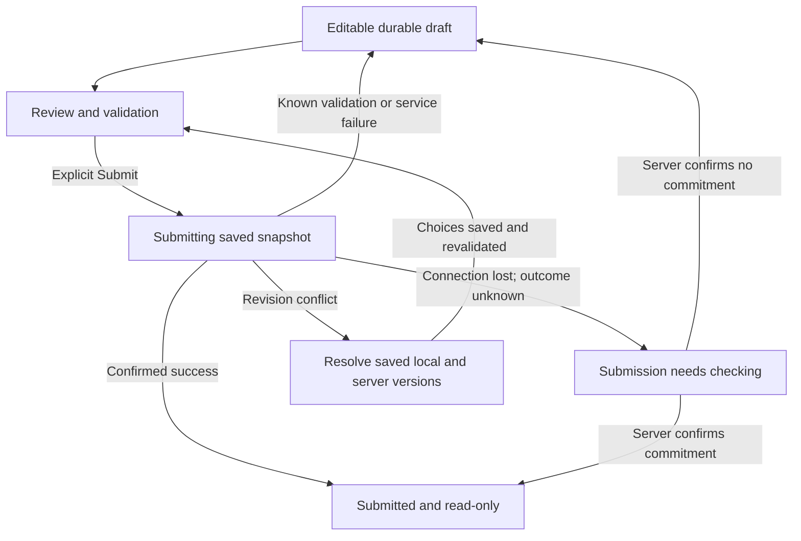

# Site visit report: shared flow for native iOS and Android

## Outcome and scope

Design one continuous reporting flow for a technician: open an assigned visit, record observations and equipment condition, attach photographs, review the report, and explicitly submit it. Both platforms use the same content, validation, persistence, conflict handling, and completion rules. Native navigation, input, media selection, and accessibility adapt to each platform.

This is a connected-flow plan. The supplied material is `BRIEF.md`; no existing screens, native source, service contract, device, simulator, or app runtime was supplied. The deliverable ends at planning and concept review.

### Working context and evidence

| Status | Evidence or decision | Implication |
|---|---|---|
| Observed | `BRIEF.md` specifies list and notification entry, long notes, photographs, equipment condition, interruption, offline work, durable drafts, successful-submission locking, and recoverable conflict. | Every requirement has an explicit path below. |
| Decision | Use a report overview with independently editable sections and a separate review screen. | Technicians can move among related evidence, resume a section, and inspect the complete report before committing. |
| Decision | Save locally first; submit only after a deliberate final action. | Navigation and network changes cannot imply submission. |
| Hypothesis | One report belongs to one visit; a visit may contain multiple assigned equipment items. | Equipment is represented as a list with a condition per item. A single-item visit uses the same model. |
| Unknown | Required photo count, condition vocabulary, note limits, supported OS versions, and server capabilities. | Explicit defaults and integration dependencies are listed below; they require confirmation before implementation. |

The applicable quality review covers the task and lifecycle, content and labels, section hierarchy, recovery, visual hierarchy, consistency, and input/access conditions. Existing visual quality and actual technician behavior cannot be inferred from this brief.

## 1. Shared product contract

### Information and validation

| Information | Location and behavior on both platforms | Planned validation |
|---|---|---|
| Visit identity, site, scheduled date/time, assignment | Read-only context at the top of the report; visit ID remains in the title when scrolling. | Match the authenticated assignment and target visit. Cached data shows its last refresh time. |
| Observations | Overview preview; full-screen multiline editor for writing and reading long notes. | Working default: require nonblank observations. Show any service-supplied limit before entry and preserve existing text if a rule changes. |
| Equipment identity and condition | Equipment section: equipment name/ID, selected condition, and an action to change it. | Explicit selection for every assigned item; no preselected condition. Proposed vocabulary: “Good”, “Needs attention”, “Not inspected”; the last choice requires a reason. Vocabulary is a product assumption. |
| Photographs | Thumbnail collection with optional caption, local/import/upload status, preview, remove, and retry actions. | Photo attachment is supported. No mandatory count is inferred from the brief; an assignment may supply evidence requirements that are displayed on both platforms. Every included file must finish importing and uploading before final commitment. |
| Draft and submission metadata | Persistent status near visit context; receipt after success. | Persist draft revision, base server revision, attachment IDs, and submission attempt identity. Show server report ID and submission time only after confirmation. |

Validate on leaving a relevant editor and on opening review. Do not interrupt typing with errors on each keystroke. Review lists linked errors in document order, focuses the first relevant error when requested, and preserves every valid value and attachment. Server validation uses the same presentation. A stale assignment or permission failure has its own explanation and recovery path.

### Selected structure

The report overview is a stable hub: visit context, save/network status, Observations, Equipment condition, Photographs, and **Review report**. Each section shows a meaningful summary and its completion/error state. “Review report” remains available with incomplete data so the technician can see what needs correction.

A fixed sequence of form steps was considered. The overview is selected because the brief allows interruption and the three kinds of evidence may be revisited together. This is a design judgment; no claim about faster completion is established.

Do not create additional app-wide navigation destinations for these report sections. They belong to the current visit. Existing primary app navigation, if any, is outside the supplied scope.

## 2. Concrete screens and visual hierarchy

Use native system typography and surfaces, restrained dividers, and one prominent action for the current task. Keep content left-aligned, labels above long values, and status understandable through text and icons. A single accent marks enabled primary actions; amber identifies recoverable attention, and red identifies errors. Color never carries the only distinction. The following copy and visit number are illustrative.

| Screen | Arrangement from top to bottom | Actions and continuation |
|---|---|---|
| **Visits** | Native title; visit rows with site, date, visit ID, and report state such as “Draft on this device”, “Submission needs checking”, or “Submitted”. | Open the assigned visit. Returning restores list position and any existing filter. |
| **Visit 2048 — Report** | Navigation bar; site/date; “Saved on this device · 14:32” plus network/server-sync status; three section groups; safe-area bottom action. Observations preview wraps to several lines with an explicit edit control. Equipment rows show full names and condition text. Photos show thumbnails and per-file status. | “Edit observations”, “Set condition”, “Add photos”, and **Review report**. An offline or conflict banner remains near the top and has a named recovery action. |
| **Observations** | Native navigation bar with visit context; persistent field label; full-height multiline text editor; unobtrusive save status; keyboard when requested. The editing area scrolls independently as one text view. | Native Back and **Done** return to the report after a durable save. “Done” finishes editing this section. Newline inserts a line break. No submission control appears here. |
| **Condition selection** | Equipment name/ID; full-label single-choice rows; reason field when “Not inspected” is chosen; Apply and Cancel. | Apply saves the completed choice atomically. Cancel leaves the previous condition intact. An unfinished selection is retained if the app is interrupted; deliberate cancellation discards only this provisional selection. |
| **Photos** | In the report: Add photos plus thumbnails. Preview opens the image at a useful size with caption and named actions. | Preview, change caption, remove, or retry a failed import/upload. Removal offers Undo and does not delete the original device photo. |
| **Review report** | Visit identity; validation summary if needed; complete observations, conditions/reasons, and photos; edit links next to each section; bottom “Submitting locks this report” explanation and **Submit report**. | Edit returns to that section and then back to review. Final submission is available when locally valid, files are ready, and a connection is available. No additional confirmation dialog duplicates this review. |
| **Submission result** | Server-confirmed “Report submitted”, report ID and time; read-only report content; **Back to visits**. | Every later entry into this submitted report is read-only. Returning through earlier screens resolves to this current state. |
| **Resolve changes** | Visit ID; explanation of the version conflict; field-by-field local/server comparison; resolution controls; saved-resolution status; **Review resolved report**. | Resolve, leave and resume, or view the latest server report. Nothing is silently overwritten. |

On compact widths, use one content column. Long equipment names and translated labels wrap; photo controls can become a vertical list. At large text sizes, stack metadata, status, and actions rather than compressing them. In landscape or a resized Android window, retain the current visit, text selection, scroll anchor, and draft. Expanded layouts can use more width for reading, without making a second pane necessary to complete the task. iPad-specific multitasking design is outside this phone-focused plan.

## 3. Entry, navigation, and return

### Shared entry resolver

Both a visit row and a notification resolve an authenticated `visitId` to the same report and durable draft. A notification is a locator; fresh service state determines whether the report is editable, conflicted, or submitted. Repeated entry must not create a second draft or submission attempt.

- **Cached visit, offline:** open its local draft immediately and show “Offline · changes saved on this device”, with the cached assignment's refresh time.
- **Uncached visit, offline:** show the visit identity if available, “Connect to load this visit”, Retry, and a route to Visits. Other saved drafts remain reachable.
- **Sign-in needed:** retain the intended visit through sign-in, then check its authorization.
- **Stale notification, deleted visit, or changed assignment:** explain the current state. Preserve local work according to the account's retention/access policy and provide an authorized recovery route; never attach it to a different visit automatically.

### Platform navigation decisions

| Situation | Native iOS | Native Android | Reason |
|---|---|---|---|
| List entry | Push Report onto the Visits navigation stack. The labeled Back control and native edge-swipe return to Visits. | Navigate within the app task. Top-app-bar Up and system Back return to Visits when the keyboard and supporting surfaces are closed. | Preserve local hierarchy and familiar return controls. [S1] |
| Notification, cold start | Establish Visits → Report as the app's navigation path. The app supplies a useful parent; it does not simulate a return to Notification Center. | Treat Report as a normal destination and establish a complete Visits → Report back stack for the notification task. Back reaches Visits, then exits the task at its root; Up never exits the app. | A report is part of the normal product flow. Android documents this notification-stack distinction. [S1, S2] |
| Notification, app already open | Persist active work, reuse the current report if it matches, and otherwise route to the notified visit with Visits as its parent. | Persist active work; handle the notification idempotently and establish/reuse the target's canonical stack without duplicate Report entries. | A second notification cannot lose the previous visit's draft. Exact task/launch behavior needs a native test. |
| Notes editor | Push a full-screen editor; Back, edge-swipe, or Done commits local changes and returns to the originating section. | Use a full-screen destination with Up/Done. First system Back dismisses the IME; a subsequent Back returns to the report. | Long notes receive adequate space and predictable keyboard behavior. |
| At Visits root | Existing app-root behavior applies; no fabricated parent. | No Up action. System Back can leave the app task. | Up describes app hierarchy; Back reflects navigation and task history. [S1] |

Every app-controlled exit waits for the local save result. Normal navigation needs no discard prompt. A failed save is an actual risk of data loss and receives the exception described below. Native gestures must have the same save semantics as visible buttons.

## 4. Platform-specific input and supporting tasks

### Keyboard and long observations

**iOS:** Use a native multiline text editor that supports selection, dictation, and system editing controls. Size its visible region against the keyboard/safe area, keep the caret and current line visible, and preserve cursor position through rotation and temporary interruption. A keyboard-accessible Done/dismiss control hides the keyboard; the navigation-bar Done returns to the report. Use the supported keyboard layout mechanisms for the selected UIKit/SwiftUI implementation. Apple's keyboard layout guide explicitly accounts for keyboard position and safe-area changes. [S3]

**Android:** Use a native multiline field with IME insets and synchronized layout changes. Keep the caret visible above the IME and the gesture/navigation area. Let the system's first Back dismiss the keyboard; do not override it with report navigation. Up/Done can finish editing, dismiss the IME, and return after saving. The plan requires native IME behavior; a web-style fixed footer is unsuitable for verifying it. [S4]

On both platforms, reopening the draft restores content and section position without forcing the keyboard open. Returning from a short interruption may retain an active editing session when the OS permits. The final Submit action never shares the keyboard's return key.

### Photos and condition selection

**iOS:** “Add photos” offers Take photo and Choose photos, then invokes the platform camera or system photo picker. Camera is full screen. Condition selection uses a modal sheet for the short, contextual choice; allow it to expand for long labels or larger text. The parent report cannot be edited while this modal task is open. Apply saves; Cancel or an unmodified dismiss returns unchanged. If an entered reason would be lost, offer Keep editing or Discard selection. Apple describes sheets as scoped contextual tasks and recommends a different presentation for prolonged editing, which supports the separate notes screen. [S5]

**Android:** “Add photos” uses a Material modal bottom sheet for source choice, then the system Photo Picker or camera. System Back dismisses the current supporting surface before leaving the report. A condition sheet uses radio semantics and Apply/Cancel; it expands to a full-height scrolling surface when content requires it. On supported devices, Photo Picker grants access to selected media; use its documented document-picker fallback when unavailable. [S6]

For both: canceling camera/picker changes nothing; camera permission is requested when Take photo is selected. Denial leaves Choose photos and the draft available, with an explanation and Settings route when relevant. A cloud-only asset that cannot download offline stays “Import pending”; it never appears as successfully attached. Persist imported bytes in app-controlled storage before showing “Saved on device”. Do not rely solely on temporary picker URLs or in-memory thumbnails. On interruption, resume the import or offer Retry/Remove while retaining all other work.

### Accessible operation

Use iOS Dynamic Type and Android font scaling. Define touch-target baselines as a product target of at least 44 × 44 pt on iOS and the Android recommendation of at least 48 × 48 dp; preserve the units. Use native semantic headings, field labels, selected states, and meaningful groups. [S7, S8]

VoiceOver and TalkBack must independently reach photograph preview, remove, and retry controls. Name repeated actions with context, for example “Remove photo 2, pump housing”. Announce submission success, conflict, and relevant error changes once; do not announce every autosave keystroke. Restore accessibility focus to the invoking section after returning from an editor or picker. Provide named controls or native accessibility actions for every significant gesture. Neither layout specification nor source review verifies the resulting accessibility tree.

## 5. Durable drafts and interruption

Persist one draft per account, visit, and report, with a local revision and base server revision. Draft content, selected conditions, reasons, attachment manifest/bytes, pending imports, and any in-flight submission record belong in durable local storage. Scroll and cursor position are separate lightweight restoration state. Android's state guidance distinguishes local persistence from activity/process restoration mechanisms; the product requirement here extends through leaving and relaunching the app. [S9]

Apply edits to a serialized local transaction/journal, then publish the “Saved on this device” indication. Save continuously as edits are accepted and flush before app-controlled navigation; a lifecycle callback or timer alone is insufficient as the persistence contract. Any server backup/sync is a separate, revision-checked operation. Display “Synced at …” only after its acknowledgement. OS background execution may be delayed, so reopening also reconciles pending work.

| Event | Required behavior |
|---|---|
| Back, Done, opening another visit, or tapping another notification | Commit the current draft first; preserve section position. Restore it when the technician returns. |
| Home, call, backgrounding, process recreation, or relaunch | Recover the last durably committed draft and pending operation. Never mark uncommitted input as saved. Native lifecycle testing must establish the accepted-edit loss window. |
| Connection disappears | Continue local editing. Show offline state; retain imports/uploads for retry. Reconnect refreshes the server revision and resumes eligible work. |
| Storage full or local write failure | Replace saved status with “Changes could not be saved on this device”. Keep the current input in memory, offer Retry and available recovery such as copying notes. Explain actual loss risk before a controlled exit. Do not show a successful-save message. |
| Server backup fails | Keep the local draft editable and show “Saved on this device · sync needs retry”. Preserve revision information and offer Retry. |

## 6. Submission and conflict model

### Explicit final commitment

Review and correction work offline. The final action explains that connection is required and remains unavailable offline; reconnection makes it available for a fresh explicit tap. There is no automatic submission queue.

On Submit report, durably record an immutable snapshot, the base server revision, and a unique attempt key before sending. Disable repeated taps, show progress, and retain the snapshot through navigation or process death. The server must validate permissions, required data, uploaded attachment availability, and revision, then atomically commit the report and return a receipt. Retries for the same snapshot use the same attempt key.

| State | What the technician sees and can do | Data and editing policy |
|---|---|---|
| Submitting | “Submitting report…”; meaningful upload/commit progress where known; return to Visits. | Snapshot retained. Temporarily guard edits to that snapshot; leaving does not imply cancellation. |
| Known failure | Specific error, correction or Retry, and saved status. | Unlock editing. Retain all entered values and files. An expired session resumes the same attempt safely after sign-in. |
| Unknown outcome | “Submission needs checking. Your report is saved on this device.” Check status and Back to visits. | Retain attempt identity and temporarily hold editing of the pending snapshot. Reconcile on reconnect/open. Do not show Submitted or permit a second independent attempt. |
| Confirmed success | Receipt with report ID/time and read-only content. | Permanent lock is applied only after an authoritative successful result, including recovery of a previously successful attempt. |
| Conflict | “This report changed since you started. Your draft is preserved.” Resolve changes and View latest. | Save local snapshot, base revision, and server version separately; guard final submission until resolved. |

An HTTP timeout does not prove failure. Status lookup must distinguish committed, still processing, definitively rejected, and definitively not committed. Only a definitive noncommit result can return the pending snapshot to editing. Repeating an idempotent request is permitted when required by the service contract; it must return the original result if already committed.

### Recoverable conflict

Show each changed field with **Your draft** and **Latest saved version**, including actor/time if the service supplies them. Keep full notes available. For each conflicting value, let the technician keep the local version, use the server version, or edit a combined result. Unchanged fields carry forward. Present photo additions/removals by stable asset identity; merging must not silently delete evidence.

Save partial resolution choices locally so the technician can leave and resume. Fetch the latest revision again before final review. A resolved draft uses that revision as its base; show a new conflict if another update races with submission. After changed content is reviewed, a fresh explicit Submit creates a new attempt key.

If another actor already submitted and locked the report, display the authoritative report and retain the local material as a separate recoverable draft accessible from that visit. It can be viewed/copied under the account's access policy. Any amendment or reassignment process requires an actual product capability; this plan does not invent a reopening action.

## 7. Dependencies and bounded assumptions

| Owner | Decision or capability to confirm before implementation | Effect if unavailable |
|---|---|---|
| Product/domain owner | Condition taxonomy, whether notes/photos are mandatory, allowed evidence limits, and multi-equipment visits. | Update the shared schema and validation on both platforms; retain entered content during migration. |
| Service owner | Version checks, atomic submission, stable attachment identities, idempotency, and authoritative attempt-status lookup. | The proposed conflict and unknown-outcome recovery cannot be claimed as implemented. Resolve the API contract before release. |
| Product/security owner | Retention of recovered work after assignment/permission changes and treatment of already-submitted local drafts. | Keep recovery within authorized access; exact disposition remains unresolved. |
| Native teams | Minimum OS versions, chosen native frameworks, storage reliability, import durability, notification routing, and background transfer behavior. | Select supported APIs/fallbacks and perform the native checks below. |

These are handoff dependencies. They do not prevent completing the requested design plan.

## 8. Concept review and verification

### Checks actually performed

The following are expert document walkthroughs against `BRIEF.md`, performed on this plan without an app runtime. They establish representation and internal consistency in the plan.

| Check | Observed result in the plan | Status |
|---|---|---|
| Required content and task coverage | Observations, equipment conditions, photo capture/import, review, and explicit submission have defined locations, actions, and outcomes. | supported_in_conditions: document review |
| List and notification entry | Both resolve the same draft; cold/warm notification behavior and platform-specific return paths are specified. | supported_in_conditions: document review |
| Long notes with keyboard | Dedicated editor, visible caret, native dismissal, preserved position, and separate final commitment are specified. | supported_in_conditions: document review |
| Leaving, interruption, and offline work | Durable draft contract, save failure, uncached offline entry, and interrupted import are covered. | supported_in_conditions: document review |
| Duplicate taps and lost submission response | Attempt identity, retained snapshot, status reconciliation, and confirmed-success lock form a consistent path. | supported_in_conditions: document review |
| Server conflict and already-submitted report | Both versions survive, partial resolution persists, renewed review is required, and locked-server recovery is defined. | supported_in_conditions: document review |
| Supporting task cancellation and accessibility intent | Apply/cancel semantics, focus return, named photo actions, text scaling, and native-unit targets are defined. | supported_in_conditions: document review |

Primary platform documentation was read to inform the decisions. Apple pages that expose JavaScript shells were read through their linked Markdown representations. A file-level check verifies the delivered Markdown's presence, expected sections, balanced fences, and source references; this does not execute the proposed interface.

### Native acceptance checks still required

All entries below are **unverified**; no observation is recorded. No simulator, device, or native app runtime was available. No browser was installed, and browser execution would not establish these native behaviors.

| Expected property | Method and conditions |
|---|---|
| Enter the correct report and preserve the prior draft | On real iOS/Android builds: cold and warm notification entry; same/different visit; duplicate and stale notification; signed-out entry. Exercise iOS Back/edge-swipe and Android Up/system Back through app/task boundaries. |
| Finish long notes with usable keyboard space | Small phone, landscape, large text, multiline content, cursor near the end, dictation, and hardware keyboard where supported. Observe caret visibility, Done, first/second Android Back, and return without unwanted autofocus. |
| Persist all content and asset bytes | Enter text and conditions, import/capture photos, wait for the saved indicator, then leave, background, kill/recreate the process, and relaunch offline. Verify restored values and files. Inject local storage failure and interruption during an edit/import. |
| Reconcile send ambiguity without duplicates | Delay/drop the success response after server commit; relaunch; retry status lookup; double-tap Submit; interrupt uploads. Verify one committed report and no permanent lock before authoritative success. |
| Recover conflicting revisions | Edit from two clients, change a note/condition/photo, trigger a conflict, partially resolve, leave/reopen, and race a second update. Verify both originals survive and review uses the latest base revision. |
| Respect photo permission and cancellation | Deny/restrict camera/media access, cancel each system surface, select unavailable cloud media, and interrupt a transfer. Verify the draft remains usable and failed files remain identifiable. |
| Provide accessible, adaptable operation | VoiceOver/TalkBack, native accessibility-tree inspection, large text, increased display scale, long localization strings, and reduced motion. Verify reading order, selected states, action labels, focus restoration, target bounds, contrast, and status announcements. |

No runtime, usability-study, visual-rendering, or complete-accessibility claim is made. The next implementation owner receives a completed plan with these concrete acceptance conditions.

## Sources and how they affected the design

Accessed 5 November 2026. These are primary platform guidance and technical documentation; they do not establish behavior or preferences of this product's technicians.

- **S1 — Android Developers, [Principles of navigation](https://developer.android.com/guide/navigation/principles).** Supports the distinction between app hierarchy, Back, Up, and task boundaries; informs the navigation table.
- **S2 — Android Developers, [Start an Activity from a Notification](https://developer.android.com/develop/ui/views/notifications/navigation).** Its regular-destination guidance supports constructing a meaningful notification back stack. Exact framework and warm-task behavior remain implementation checks.
- **S3 — Apple, [Adjusting your layout with keyboard layout guide](https://developer.apple.com/documentation/uikit/adjusting-your-layout-with-keyboard-layout-guide).** Read the linked Markdown source; informs iOS keyboard/safe-area handling. It is UIKit technical guidance, not a prescription of the application's framework.
- **S4 — Android Developers, [Use keyboard IME animations](https://developer.android.com/develop/ui/compose/system/keyboard-animations).** Supports IME-aware layout and synchronized inset changes; the design applies regardless of whether the eventual app uses Compose or Views.
- **S5 — Apple Human Interface Guidelines, [Sheets](https://developer.apple.com/design/human-interface-guidelines/sheets).** Read the linked Markdown source; supports short supporting sheets and a dedicated surface for prolonged notes. Modal/nonmodal semantics remain explicit in this plan.
- **S6 — Android Developers, [Photo picker](https://developer.android.com/training/data-storage/shared/photo-picker).** Supports system media selection, selected-media access, cloud-media handling, and the documented document-picker fallback.
- **S7 — Apple Human Interface Guidelines, [Accessibility](https://developer.apple.com/design/human-interface-guidelines/accessibility).** Read relevant Markdown sections on larger text, contrast, and access technologies; informs adaptation and future native accessibility checks. The 44 pt baseline is a design target here.
- **S8 — Android Developers, [Make apps more accessible](https://developer.android.com/guide/topics/ui/accessibility/apps).** Supports touch-target sizing, action descriptions, and text visibility; informs native semantics and future verification.
- **S9 — Android Developers, [Save UI states](https://developer.android.com/topic/libraries/architecture/saving-states).** Supports separating durable local storage from transient UI restoration. Cross-platform draft durability and the submission/conflict policy are product decisions derived from the brief.
