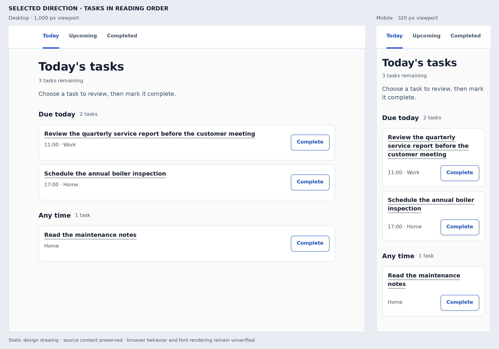

# Today’s tasks — concrete redesign

## Selected direction

Use one calm, readable task list with a strong page title, clearly separated due-time groups, and a consistent action on every task. Keep the existing **Today / Upcoming / Completed** destinations and the **Due today / Any time** grouping. Give each task a readable title, associated metadata, and the same `Complete` button.

The scope is the **Today screen and its immediate detail/completion states**. The requested endpoint is a design plan. Application code has not been changed.

The image is a static design drawing at representative widths of **1,000 and 320 CSS px**, using the supplied task content. It is not a screenshot of a running implementation. DejaVu Sans approximates the proposed system font; production font metrics and browser layout remain to be checked. The mobile drawing shows the full content; shorter viewports scroll vertically.

## Brief and evidence

The working audience is a person reviewing their own tasks on desktop or mobile web. They enter Today, identify the next task, review its details when necessary, and mark it complete. This audience and cross-device use are design assumptions inferred from the supplied page and viewport metadata. No research about this product’s users was supplied.

| Status | Evidence or choice | Implication |
| --- | --- | --- |
| Reported | The request says the workflow mostly works and the screen feels difficult to read and unfinished. | Concentrate on readability, composition, consistency, and immediate feedback. |
| Observed in `index.html` | All headings and paragraphs are reset to 12 px Arial; the summary alone is 30 px with 30 px padding. | The count dominates while the task and heading hierarchy is visually flattened. |
| Observed in `index.html` | Body text is `#b7b7b7`; normal buttons use 9 px `#999` on `#ddd`. | Text and actions need stronger contrast and usable sizing. |
| Observed in `index.html` | `.task:nth-child(2) button` changes the first task in **each** section to an orange, square, 16 px serif button. | Equivalent actions acquire unrelated visual meanings. This affects the report and maintenance-note tasks. |
| Observed in `index.html` | Task titles have `width:50%`; the row gap is 2 px; there are no media queries. | Replace the rigid title allocation and cramped row composition with explicit responsive behavior. Actual narrow-screen overflow was not observed in a browser. |
| Observed in `index.html` | The page contains three tasks, two groups, three navigation links, and three native buttons. `aria-current="page"`, headings, and one labelled section already exist. | Preserve these useful foundations and complete the semantic relationships. |
| Unknown | The supplied HTML has no scripts, event handlers, detail links, or targets for `#upcoming` and `#completed`. | The source does not establish the reported working workflow. Integration and runtime behavior remain unverified. |
| Decision | Redesign the screen with one reusable task component and a coherent scale, spacing, and color system. | The priority problems can be addressed without changing the product’s grouping or adding extra navigation levels. |

The visual scan also covered content, grouping, interaction/recovery, consistency, and access conditions. Task wording and group names are understandable in the supplied context. Forms, permissions, search, bulk actions, and cross-channel handoffs have no evidence or requirement here.

## Content and placement

Preserve the complete titles, time strings, categories, and source ordering:

| Group | Full task title | Metadata | Proposed placement |
| --- | --- | --- | --- |
| Due today | Review the quarterly service report before the customer meeting | `11:00 · Work` | First task; full title above metadata, completion action beside the content on wide screens. |
| Due today | Schedule the annual boiler inspection | `17:00 · Home` | Second task, using exactly the same component. |
| Any time | Read the maintenance notes | `Home` | Third task, under its existing group; no invented due time. |

The reading order is navigation → page title → remaining count → short instruction → Due today tasks → Any time task. Set the count to `3 tasks remaining` in the initial design and derive it from incomplete tasks in a future implementation. Group counts are `2 tasks` and `1 task`.

Keep the instruction close to the page title: **“Choose a task to review, then mark it complete.”** Retain the full task names without ellipsis or a fixed line limit. “Due today” remains a time grouping; the supplied data does not justify invented priority or overdue labels.

## Visual specification

Use a neutral, practical appearance: cool light background, white task surfaces, dark text, and blue controls. Group headings and spacing establish structure. Thin borders help distinguish the task surfaces without adding heavy shadows.

| Element | Chosen treatment |
| --- | --- |
| Page | Background `#F8FAFC`; centered content width up to **832 px**; minimum side padding **16 px**. Header and content share the same horizontal alignment. |
| Navigation | White band, approximately **64 px** tall at default text size. Each link has a minimum **44 px** height. Current `Today` is semibold blue with a **3 px underline**, supported by `aria-current="page"`. |
| Main spacing | About **32 px** below navigation on desktop, **24 px** on mobile. Use **32 px** between major groups, **12 px** between tasks, and **16 px** inside a task. |
| Page title | **32/40 px**, weight 700; **28/36 px** below 600 px. |
| Section title | **18/28 px**, weight 600–700. The count beside it uses **14/20 px** regular secondary text. |
| Task title | **16/24 px**, weight 600–700; `#172033`. A consistently underlined title link identifies the review-details action. |
| Instructions | **16/24 px**, regular, `#475569`. |
| Task metadata and remaining count | **14/20 px**, regular, `#475569`. Keep metadata directly associated with its task. |
| Task surface | White, **1 px `#DBE2EA`** border, **10 px** corner radius. Content determines height; desktop rows are at least about **100 px** at the default scale. |
| Complete button | White background, **1 px `#1D4ED8`** border, matching text, **14/20 px** semibold, **8 px** radius. Minimum **44 px** height; approximately **108 px** wide in the English mockup, with content-driven growth. |
| Focus | **3 px `#1D4ED8`** outline with **2 px** offset around the focused control, kept clear of clipping. |
| Hover/pressed | Hover background `#EFF6FF`; pressed background `#DBEAFE`. Preserve readable text and explicit labels in both states. |

Use `system-ui, -apple-system, Segoe UI, sans-serif`; implement font sizes in relative units and support text resizing. These numerical choices describe this design. They are not universal requirements for every task application.

### Responsive layout

At **600 px and wider**, use two task columns: a flexible content block and an action block. Give the title all the remaining width rather than fixing it to half the row. Keep the action separate from the title link and vertically centered.

Below **600 px**, the title spans the task width. Metadata and `Complete` sit beneath it; their footer wraps when enlarged text or translated labels need more space. At 320 px, page padding leaves 288 px for the task, and task padding leaves 256 px for its contents. The supplied title remains fully visible across several lines. No task height is fixed.

Keep the three navigation destinations visible. Let the navigation wrap if enlarged labels exceed the width, allowing the header to grow. Preserve reading order and reachable actions at 200% text size and at a 320 CSS px viewport. The illustration demonstrates the selected composition; those browser conditions are future checks.

### Alternatives considered

A compact table with aligned title/time/category/action columns would support larger comparison workloads. With the supplied three tasks and long titles, the chosen list gives the title more space and adapts more directly to a narrow screen. Separate Work and Home columns would split the existing due-time scan and duplicate the task structure. Retain time-based groups and use category as metadata. Revisit density if actual task volume or expert comparison needs differ from this example.

## Connected interaction states

These are proposed behaviors for the implementation handoff. The supplied file does not prove a service or handler exists for them.

| State or action | Concrete behavior |
| --- | --- |
| Review details | Activate the underlined task title. Preserve the real product’s detail destination and data when integrating. Give that view a `Back to Today` link, a wrapping **24/32 px** task heading, the same time/category labels, any existing details, and the same completion action. Preserve list scroll position on return. No extra description is invented. The actual detail binding must be located in the working product. |
| Complete | The named button affects only its own task. While saving, keep the row present, show `Completing…`, and prevent a duplicate submission. Preserve sufficient width for the temporary label. |
| Completion succeeds | Move the task to Completed, update the remaining and group counts, and show a persistent inline status above the list: `Task completed.` with `Undo`. Announce the result politely. Preserve the task’s group and position for restoration. |
| Undo | Restore that task and the counts. Retain the recovery message until explicitly dismissed or navigation occurs. If the real service lacks reopening, this is an integration dependency to resolve before claiming the action works. |
| Completion fails | Keep the original task and counts. Show `Couldn’t complete this task. Try again.` immediately below that task, with a `Retry` action. Announce the error and retain a logical focus position. |
| A group becomes empty | Replace its tasks with a compact sentence such as `No tasks due today.` Keep the group heading and zero count so the change is understandable. |
| Today becomes empty | Show `You’re done for today.` and links to Upcoming and Completed. Use the same navigation and typography; remove the task list. |

Use native links and buttons. Give each completion control an accessible name beginning with its visible label, for example `Complete: Schedule the annual boiler inspection`. Use one `h1`, group `h2` headings, task `h3` headings, labelled sections, and lists where appropriate. Keep source and visual order aligned. The title link and completion button are independently operable; avoid wrapping both inside another interactive control.

After removing a completed row, place focus on the next task’s completion control, then the previous one if needed, or the empty-state heading if no tasks remain. Keep the new status and Undo before the list in the logical order. Direct entry, browser history, announcements, and actual focus movement require runtime verification.

## Research and its effect on the design

Research question: **How should a short task screen distribute visual emphasis and remain legible when text, controls, and viewport size change?** Sources were opened and read on **5 November 2026**.

| Source | Type and applicable finding | Decision and limit |
| --- | --- | --- |
| [Kelley Gordon, NN/g — 5 Principles of Visual Design in UX](https://www.nngroup.com/articles/principles-visual-design/) | Practitioner guidance on scale, hierarchy, contrast, and grouping. Published 2020; the retrieved page reports review in 2026. | Make task content prominent, reduce the count’s prominence, and use consistent groups. This supports design judgment; it supplies no measured result for this audience. |
| [W3C — Understanding SC 1.4.3, Contrast (Minimum)](https://www.w3.org/WAI/WCAG22/Understanding/contrast-minimum.html) | Informative explanation reproducing the WCAG 2.2 AA criterion: normally **4.5:1** for text and **3:1** for large text, with stated exceptions. | Select dark text and blue controls with contrast margin. Color-pair calculations verify the chosen pairs, not whole-product accessibility. |
| [W3C — Understanding SC 1.4.10, Reflow](https://www.w3.org/WAI/WCAG22/Understanding/reflow.html) | Informative explanation of reflow, including **320 CSS px** width for horizontally written content under the criterion’s conditions. | Let long titles and the footer wrap, and preserve all actions. A static drawing cannot establish browser reflow. |
| [W3C — Understanding SC 2.5.8, Target Size (Minimum)](https://www.w3.org/WAI/WCAG22/Understanding/target-size-minimum.html) | Informative explanation of the **24 × 24 CSS px** minimum, applicable exceptions, and benefits of larger controls. | Choose **44 px** control height for this interface. This is a design choice above the criterion’s minimum; native-platform dimensions have not been imposed on the web. |

## Checks actually performed

| Check | Method and conditions | Observed result / status |
| --- | --- | --- |
| Source inventory | Read the complete supplied `index.html`; parsed its elements, IDs, links, scripts, and inline handlers with Python. | Three tasks, two groups, three native buttons, three navigation links; no scripts or inline handlers. `#upcoming` and `#completed` lack targets. **Supported within this source.** |
| Existing text contrast | Calculated relative luminance from the source CSS’s solid sRGB color pairs. | Body on white **2.01:1**, body on `#FAFAFA` **1.92:1**; navigation **2.23:1**; summary **2.10:1**; normal button **2.10:1**; orange button **1.97:1**. **Mismatch** with the applicable text thresholds for these enabled labels. |
| Proposed color pairs | Used the same formula for the specified default palette. | `#172033` on white **16.27:1**; `#475569` on white **7.58:1**; `#1D4ED8` on white **6.70:1**, and on hover `#EFF6FF` **6.16:1**. **Supported for these color pairs.** |
| Concept walkthrough | Expert review using the supplied three tasks, the selected composition, and the proposed state table. | All titles, metadata, groups, destinations, and completion actions have a defined location; detail, saving, success, recovery, failure, and empty states are specified. **Supported as a design review.** No participant success or improvement was measured. |
| Static visual review | Generated and inspected the PNG drawing with the full long title at 1,000 and 320 px widths; checked drawing bounds. | The wide layout and narrow layout retain all three task titles, metadata, and controls. Final drawing content remains inside its frames. **Supported for this drawing.** |
| Application preservation | Compared SHA-256 before and after creating the deliverables. | `index.html` remains byte-for-byte unchanged: `81a9e1ca08d346fe452ec7f0213350b96464e840aac5c80e69b528d8cc62d1bd`. |

### Checks for a future implementation

| Expectation | Method and conditions | Status |
| --- | --- | --- |
| All task content and actions remain visible without horizontal page scrolling. | Inspect the running screen at 320, 390, 768, and 1,440 CSS px; 200% text size; and a 1,280 px viewport at 400% browser zoom. | Unverified. |
| Navigation, details, and completion reach the intended outcomes. | Exercise each destination, detail entry/return, successful completion, failed save, retry, and undo against the real service; reload to check persistence. | Unverified. |
| Keyboard and assistive-technology operation match the plan. | Test Tab/Shift+Tab, Enter/Space, focus after row removal, current-page announcement, control names, and status/error announcements. | Unverified. |
| Actual controls and states retain sufficient contrast and target size. | Measure computed styles and rendered bounds in default, hover, focus, saving, error, and enlarged-text states. | Unverified. |

There is no usable local browser executable in this environment. No browser installation, browser interaction, accessibility-tree inspection, screenshot of the application, or user study was performed. The next implementation owner should locate the working detail/completion/navigation bindings, apply this visual specification, and execute the bounded checks above.
